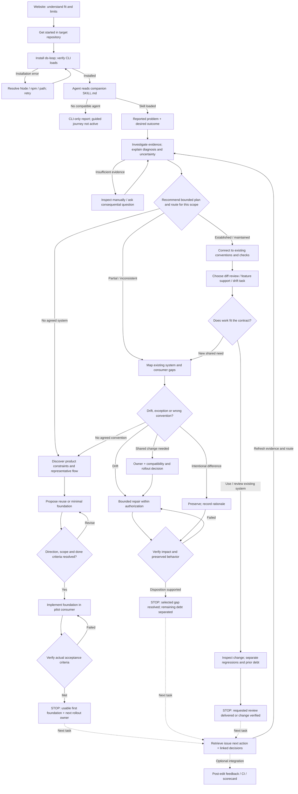

# Design System Loop — website onboarding and three user journeys

UX specification, 19 September 2026. Supersedes the six-panel developer-task illustration as the primary onboarding map. The map remains a UX specification. Core consulting instructions are now implemented locally in `skill/` and under evaluation; acquisition and rendered end-to-end behavior are not proved by that implementation. No new npm release is implied.

[Open the technical flowchart](design-system-loop-onboarding-2026-09-19.html)

**Authority:** the HTML flowchart is canonical for nodes, routing, recovery and end states. This document explains that flow. Its Mermaid block is a deliberately simplified overview; it omits some recovery nodes and is not a second complete specification. Change the HTML first, then update the relevant explanation and overview.

## Scope

Map the complete first-use experience: website discovery → installation → explicit skill activation → intake and evidence → one of three routes → a useful first outcome → returning work. These are product-area starting situations, not engine-derived maturity scores. A single company can have different situations in different areas.

## Common path

| Step | Surface / owner | User experience | Exit / recovery |
| --- | --- | --- | --- |
| 01 Discover | Website / user | Understand Start, Improve and Maintain, see a concrete example and supported limits. Choose Get started. | User understands whether this fits their need. |
| 02 Setup | Setup page / user | Open the target repo; check Node 22.6+ and npm. Explain terminal-only versus agent-guided use. | Correct prerequisites and working directory. |
| 03 Install | Terminal / user | `npm install --save-dev ds-loop`, then `npx ds-loop --help`. | Help loads. Installation/path errors return to setup; audit findings are not install failures. |
| 04 Activate | Coding agent / user | Ask the agent to read `node_modules/ds-loop/skill/SKILL.md` in the same repo. | Agent loads the skill. npm alone does not activate it. CLI-only users can inspect reports and stop there. |
| 05 Problem | Agent following skill / user | “What brought you here, and what would you like to be easier or work better?” Reuse a supplied goal; ask for a concrete example only when useful. | Requested outcome and affected area understood enough to investigate. |
| 06 Diagnosis | Skill + engine | Read commitments, consumers and relevant UI; run context and unfiltered audit. Connect evidence to the reported problem, distinguishing possible causes and unknowns. | Evidence supports a recommendation, or a bounded discovery task is identified. |
| 07 Plan and route | Skill recommends / user or owner resolves | Explain the first intervention, alternatives, scope, owner and observable finish line; select A, B or C for this area. | Proceed within existing authorization; resolve only material missing decisions. |

Activation prompt:

```text
Read node_modules/ds-loop/skill/SKILL.md.
Help me get started with this repository.
Understand what I want to improve, inspect relevant evidence,
then explain the diagnosis and recommend a bounded first delivery.
Do not start a broad migration.
```

If the user has already supplied the task and scope, do not repeat intake questions. Read repository answers before asking about implementation facts. The initial question is for user intent, not a mandatory technical interview.

## Diagnosis and plan — refinement, 20 September

Use the [diagnosis and plan specification](CONSULTING-DIAGNOSIS-AND-PLAN-2026-09-20.md) for the interview guide, evidence requirements, user-facing plan template, and evaluation scenarios. It replaces maturity-first intake with a problem-first conversation. Starting conditions inform a route; they do not establish which intervention is worthwhile.

A concrete authorized task can use a short plan. Broad pain requires a diagnosis connecting evidence, cause, consequence and recommendation. Where evidence is insufficient, propose bounded discovery. Present the plan in conversation or the team's existing task; a new document or presentation is optional. These instructions now exist in the local skill revision; behavioral evaluations and release status are recorded separately. They are not yet shipped in a new npm release.

## A — No agreed design system: establish

1. Discover one representative product flow, platforms, themes, accessibility needs, constraints and decision owner. Existing product: inventory relevant repeated UI. Greenfield: use the product brief and a prototype/reference flow.
2. Propose reuse of an existing library or a minimal foundation appropriate to the actual need. Explain tokens, components, naming and tradeoffs through a rendered example. Do not mandate a universal tier model or token format.
3. Resolve the direction, allowed pilot scope and acceptance criteria. Reuse existing authorization; ask only when a material decision or scope is missing.
4. Implement the agreed foundation in one representative consumer, with appropriate focused tests/stories and usage guidance.
5. Verify rendered behavior and the agreed states with appropriate methods; rerun the unfiltered engine audit and preserve limits. Revise the design or implementation if checks fail.
6. **Stop:** the first foundation is usable in its pilot, evidence and decisions are discoverable, and the next rollout area and owner are explicit. Wider adoption is separately scoped; it is not automatic.

First value: a demonstrated reusable foundation, not just generated token files.

## B — Partial or inconsistent system: improve

1. Map existing tokens, components, consumers, stated conventions and recurring pain. “Bad” is a starting perception, not a verified defect list.
2. Determine whether a difference is drift, an intentional exception, a convention that needs changing, or an inability of the checker to represent the system. Choose one meaningful pilot by impact and consumer reach.
3. Resolve ownership and scope. Local authorized repair proceeds. Shared/breaking changes need a consumer and rollout plan with the existing owner. No convention in this area routes that area to A.
4. Repair within scope, or preserve a justified difference. Store the decision in the team's existing home; use a supported `config.ignore` entry with a reason when a rule exception is appropriate. Documentation and suppression are distinct actions.
5. Verify before/after behavior and affected consumers. Preserve source, configuration and coverage. Changed configuration is not evidence of product improvement.
6. **Stop:** the selected gap has a verified disposition, remaining debt is separated, and decisions are retrievable. More migration is another scope decision.

First value: a proven gap resolved without turning the task into an unbounded cleanup. An evidence-backed no-op can succeed.

## C — Established, maintained system: maintain

1. Find existing contracts, owners, records, checks and entry points. Configure the scanner only if it faithfully represents the conventions; state unsupported checks.
2. Agree how developers return: review a diff, build using existing patterns, or inspect new drift. Optional Claude hook/CI setup is separate and deliberate.
3. Review whether the actual new work fits the system. Reuse existing patterns when it does. A violation can lead to an authorized local repair; a new shared need routes that scope to B.
4. For a diff review, establish the actual base ref and use `audit . --since <ref> --json` without a severity filter. The agent separately reviews affected behavior, consumers and relevant token dependencies. A component review playbook does not by itself define an arbitrary-diff review route.
5. Separate new regressions, existing debt, exceptions and unverified behavior. Repeat the relevant check after a repair; do not reinvent the foundation.
6. **Stop:** the requested review is delivered, or the authorized change meets its agreed checks. A review can finish by reporting issues; it does not require fixing all of them. Merge/release follows the team's existing process.

First value: useful change guidance that preserves established commitments.

## Recovery and rerouting

| Condition | Response | Resume / end |
| --- | --- | --- |
| CLI fails to load | Show exact environment/path failure. | Retry installation verification. |
| Agent cannot read skill | Check host capabilities, working directory and complete package path. | Activate explicitly, or retain terminal-only experience. |
| No code yet | Use product needs, reference flow and prototype. | Continue discovery without claiming an engine baseline. |
| Unsupported styling or unknown naming | Inspect manually or use an appropriate existing checker; configure naming only from evidence. | Continue with stated coverage. Do not classify company maturity. |
| Missing policy/owner | Present the concrete question, supporting evidence and required owner. | Await decision; preserve the next action. |
| Pilot fails acceptance | Return to implementation or revisit the design choice. | Recheck actual failed criteria. |
| Intentional difference | Verify rationale and implications; record it; suppress only where applicable and correctly scoped. | No-op outcome, not forced migration. |
| B has no agreed convention in scope | Establish that foundation. | Route that area to A. |
| C reveals a recurring gap/shared change | Make an improvement proposal. | Route that area to B. |

## Completion receipt: separate verification channels

Each handoff identifies the requested outcome, disposition, scope, relevant evidence and remaining limitation. Do not collapse these into “verified.”

| Channel | Required attribution |
| --- | --- |
| Engine checks | Command, source revision/diff, config, actual findings and coverage. These do not verify UI behavior. |
| Browser / other automated tests | Test or inspected state, method, result and evidence location. Record who or what ran it. |
| Human review / design judgment | Reviewer or authority where applicable, decision, evidence and affected scope. This is not an engine finding. |
| Not checked | Missing observation, its consequence and what would resolve it. Never mark it passing. |

Store goal, unresolved decision, owner and next action in the team's existing issue/task. Store lasting conventions in its ADR, component contract or `DESIGN-SYSTEM.md` when that is the chosen home. Link them from an existing discoverable entry point. A scorecard stores measurements, not conversation state. This proposal adds no engine session-state store.

`context --write-contract` supplies an optional draft of measurements and TODOs. Its existence alone does not establish completed decisions, retention of every task detail, or reliable retrieval. A fresh-session continuation should prove that the relevant decision can be found and applied.

## Returning use

Retrieve the relevant issue/task and linked decisions. Check for source, config or ownership changes. Resume at the appropriate checkpoint instead of repeating website setup or the entire interview. An A pilot may expand through B; routine work can enter C. Optional edit feedback, CI and scorecard comparisons support this workflow but do not automatically schedule it.

## Optional Storybook Architect handoff — scope decision, 20 September

DS Loop owns the design-system journey and can help establish a minimal Storybook when appropriate: framework-compatible configuration, existing tokens/theme providers, a representative component story, basic usage guidance, and verification that it starts and builds. Preserve another useful documentation environment; Storybook is not a prerequisite for every route.

For deeper Storybook work—library organization, documentation maintenance, story coverage, lifecycle conventions or agent discovery—offer the optional `storybook-architect` skill. Do not reproduce its full workflow inside DS Loop.

Proposed handoff:

1. Explain the specific specialist task and intended result.
2. Check whether Storybook Architect is available in the current agent host.
3. If available, load it for the authorized task. If absent, offer installation with a verified source and host-appropriate instructions; no invented install command or silent installation.
4. Carry forward repository/package location, framework and Storybook version, existing conventions, relevant decisions, permitted scope, current evidence and completion criteria. Do not repeat intake.
5. Execute the specialist task, then return its changes, checks, limits and remaining decisions to the DS Loop handoff.

Example: “The basic Storybook is running. For organizing and maintaining the library, I recommend Storybook Architect. I can use it if available, or help you install it, carrying over the context we have already gathered.”

The specialist is optional. Declining installation does not prevent completing DS Loop's basic setup or other system work. Installing the skill does not itself configure Storybook, create a background service, or grant authority to change shared conventions. The local scaffold and engagement playbooks instruct this handoff. The [evaluation record](../../ds-loop-calibration/evaluations/consulting-2026-09-20/REPORT.md) now includes a rendered setup using the available specialist skill and an unavailable-specialist trial. No specialist installation or human maintainer study was performed.

## What currently exists versus what this proposal adds

- Available: npm package and CLI; companion skill files; direct skill loading; context/audit; agent playbooks; narrow mechanical fixer; optional Claude post-edit hook; optional CI invocation; scorecard; current branch's risk text, ignore configuration and draft contract generation.
- Already instructed in part: investigate existing evidence, ask consequential questions, bound changes, check real UI and retain decisions.
- Local revision now instructs: a problem-first conversation, diagnosis and plan, evidence-informed routing, bounded delivery, separate verification channels, and end/resume states. The evaluation protocol records which behaviors have actually been exercised. Website-to-activation consistency and broader end-to-end use remain separate checks.
- Website follow-up, checked 20 September: the separately owned `site/setup.html`
  now leads with npm installation and explicit skill loading. It still targets
  published 0.1.2; the local 0.2.0 candidate needs publication before that public
  instruction changes. Local CLI improvements do not prove the full acquisition
  journey works for a new developer.

## Response to Claude's review of the earlier proposal

Accepted: keep recommendations in the skill; retain the engine's deterministic next-command boundary; acknowledge existing natural-language routing; distinguish starting from nothing from joining an existing system; inspect before asking technical questions; name record locations; separate verification channels; give diff review a route.

Clarified: file scope and severity scope are independent. A scoped audit may remain unfiltered by severity, but excluding token declarations can affect cross-file rules. Choose scope with those dependencies in mind; do not imply every `--files` or `--since` run is equivalent to a complete project audit. This proposal does not silently replace the standing setup-audit policy.

Not accepted as proof: a risk sentence is not a contextual recommendation; writing a contract does not prove retrieval; the presence of exception configuration does not establish correctness of all exception paths. Those mechanisms support the journey, but do not substitute for it.

The earlier analogy to public design-system contribution processes was inspiration for ownership, not evidence of shipped DS Loop capability. This revised flow is grounded in the user's requested acquisition and onboarding journey. A diagram is warranted here because the user explicitly needs to inspect the branches before implementation.

## Mermaid overview

Non-authoritative summary of the canonical HTML. HTML nodes E1/E2/E3 describe recovery in more detail; H explicitly defines the alternate handoff for missing decisions or evidence.



At any decision gate, missing authority can end the session as awaiting a named decision, with its owner and resumption trigger. It is not a verified implementation success.

## Follow-up review: visual defects and scoped-rule delivery

Claude reported successful browser rendering and interaction checks, plus two defects: selecting a node updated a detail pane outside the visible area, and connectors crossed section titles. The HTML now scrolls the updated detail pane into view and renders opaque section labels above the connectors. These edits need a fresh visual check; source validation alone does not establish rendered correctness.

The scoped palette-rule defect has two separate parts. File-scoped extraction can remove theme declarations needed to judge a markup use site. The local engine now separates explicitly mapped read-only CSS context from judged files using `tokenContexts`. Findings and ratios remain confined to the requested scope; consulted context is attributable. Missing scoped context is reported as unjudged. Map the applicable product/theme from repository evidence; unrelated declarations elsewhere in a monorepo must not establish policy for every component. This repair is local and unpublished; see the [evaluation record](../../ds-loop-calibration/evaluations/consulting-2026-09-20/REPORT.md).

However, the default `token/stock-palette-utility` severity is **medium** and the guard invokes audit with `--min-severity high`. Restoring context alone will not deliver this finding through the default hook. Likewise, putting a limitation in `couldNotJudge` does not notify the user through this hook: its coverage signature intentionally excludes file-scoped judgment limits. Changing either delivery policy is a separate explicit decision, not an incidental consequence of fixing scope. Preserve unfiltered audit as the existing channel.

The UX instructions and subsequent engine repair are separate changes. The default hook severity and judgment-limit delivery policy remain unchanged.
